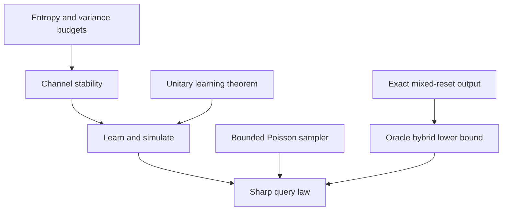

# Learning route

The target evolution is a prescribed sequence of noisy intervals and known controls. The noise depends on an unknown reflection, while the controls determine how much entropy can be removed between intervals. Understanding their interaction explains why even a two-qubit target can have very different simulation-query costs.

The single educational anchor is John Watrous, [*The Theory of Quantum Information* (Cambridge University Press, 2018)](https://cs.uwaterloo.ca/~watrous/TQI/). The [Watrous bridge](WATROUS_BRIDGE.md) identifies the relevant parts of the book, translates conventions, and supplies the route from those foundations to this project's dynamics and oracle model.

## Study the connected story

The [30-milestone map](MILESTONES.md) organizes the project's understanding targets into two phases:

| Phase | Milestones | Destination |
|---|---|---|
| Background and preliminaries | M01–M10 | Assemble states, channels, references, entropy, reflection noise, and ordinary queries into the complete simulation problem. |
| Narrative and innovation | M11–M30 | Connect control capacity, the entropy-and-variance proof, exact reset saturation, and the matching query bounds, then interpret memory, attribution, and scope. |

Each milestone records its central question, understanding target, earlier dependencies, conceptual connection, and source pointers. The map follows the scientific project rather than the textbook's chapter order. Specialist details remain in the [authoritative scientific account](../science/README.md).

## How the principal arguments meet

Two simulation algorithms supply upper bounds: learning followed by known simulation, and a bounded Poisson sampler. An exact controlled-noise construction supplies the matching oracle lower bound.

The [stability proof](../science/channel_stability.md) explains the entropy and variance budgets. The [mixed-reset construction](../science/mixed_resets.md) gives a finite output separation in every capacity regime. The [query proof](../science/query_complexity.md) assembles both upper algorithms and the lower bound, identifying the imported unitary-learning theorem explicitly.

## Return to the evidence

Use the [model](../science/model.md) for exact assumptions and normalization, [interpretation](../science/interpretation.md) for physical meaning, [related work](../references/RELATED_WORK.md) for attribution, and [verification](../verification/README.md) for the finite reproducible checks. The analytical proofs establish the universal claims; the finite suite checks its documented identities and examples.

